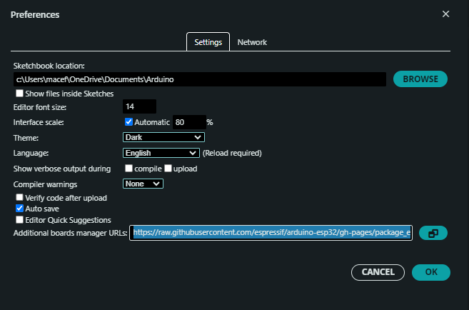
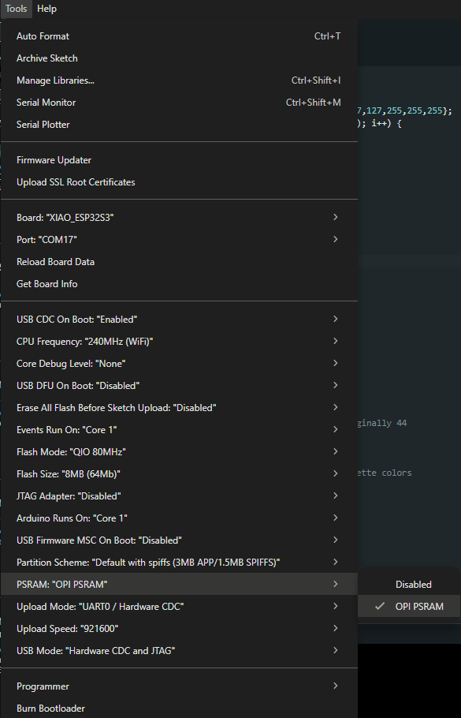
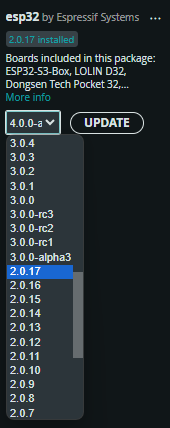
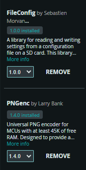
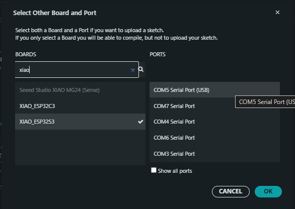

### Notes

This project is based on the instructables tutorial here: https://www.instructables.com/Tiny-Outdoor-Camera/

The file [instructions.pdf](https://github.com/May0san/Digital-Lomography-Code/blob/main/instructions.pdf) has a detailed guide of soldering and assembly. You can also find 3D files for the case here.

You will need the Arduino IDE app as well as the PNGenc library and the FileConfig library (installed within the Arduino App itself)

Flash the code found in this repository to your ESP-32 and load the SD card with the contents of SD Card Files folder. The process for loading the code to the ESP32 is very obscure so read the instructions at the bottom of this page carefully.

The Dithered version of the code will create a dithered photograph using a palette that you give it. The JPEG and PNG versions output JPEGs and PNGs of the image, respectively. The PNG encoder library used by both the Dithered and PNG versions of the code are intensive on the ESP32 and so the camera cannot handle some of the larger photo resolutions. If you tinker with it and optimize the library usage, you might be able to get larger resolutions, but I will probably not be doing this.

The config.txt file is how you swap out dither palettes or change camera settings. Each section of the config file (marked by a section name in brackets) can have at most 128 lines including comments and whitespace, so I recommend keeping the majority of palettes you're not actively using in the seperate "palette_collection.txt" file. Keep in mind as well that line lengths should not exceed 64 characters. These are limitations to my configuration of the FileConfig library. 

If you are visiting from the Picotron Community, there are also a set of palettes I made that are specifically compatible with the Picotron default palette.

### Instructions for flashing the code

- Go to File -> Preferences -> Additional boards manager URLs (you can click the little button to the right to expand) and paste the following two lines:
    `https://raw.githubusercontent.com/espressif/arduino-esp32/gh-pages/package_esp32_dev_index.json`
    `https://raw.githubusercontent.com/espressif/arduino-esp32/gh-pages/package_esp32_index.json`

    

- In Tools -> PSRAM enable OPI PSRAM. This allows the board to access and allocate PSRAM.

    

- Select Boards Manager from the toolbar on the left edge. Search for and install the esp32 library, version 2.0.17. The code is stuck on an older version of the library for the time being. Arduino IDE will occasionally prompt you to update your board libraries, but you should ignore it.

    

- Select Library Manager from the toolbar on the left edge. Search for and install both PNGenc and FileConfig.

    

- Plug your board into the computer.

- Select the box with the USB icon next to the compile, upload, and debug options. Click "Select other board and port..." Search for and select the "XIAO_ESP32S3" board as well as whichever serial port is recognized as having a board connected (in my case, it is indicated by the "(USB)" written to the right of the port name).

    

- Click the arrow pointing right to flash!
